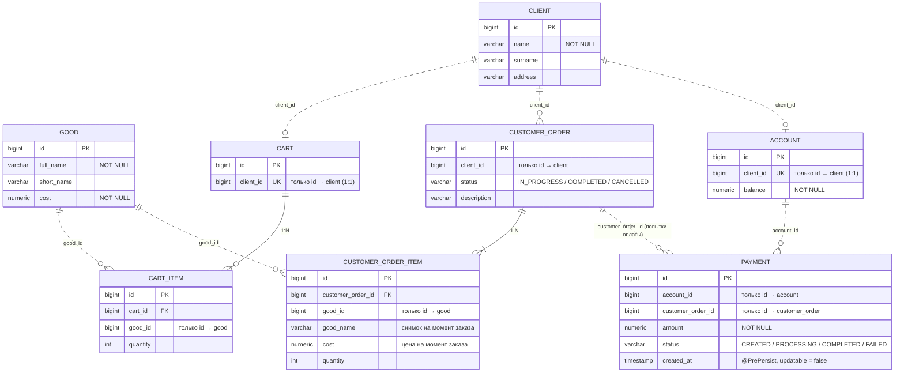

# MarketPlace_Back

Запуск keycloak:

Запуск PG:
docker run --name marketplace-pg -e POSTGRES_PASSWORD={pass} -v pgdata-mp:/var/lib/postgresql -p 5432:5432 -e POSTGRES_DB=marketplace -d postgres:18
Взаимодействие с PG:
docker exec -it <имя> psql -U postgres -d postgres:18

## Схема БД в формате ER-диаграммы

Текущее состояние JPA-сущностей (`db/entities`).

Планируется (ещё нет в сущностях):

- `CLIENT.keycloak_sub` (UK) — `sub` из JWT;
- `CUSTOMER_ORDER.created_at`, `total` (хранить или считать — открытый вопрос);
- `ACCOUNT.version` — `@Version`, оптимистичная блокировка конкурентных списаний;
- не больше одного `COMPLETED`-платежа на заказ — проверка в сервисе
  или частичный индекс `UNIQUE (customer_order_id) WHERE status = 'COMPLETED'` в миграции.

Запуск 