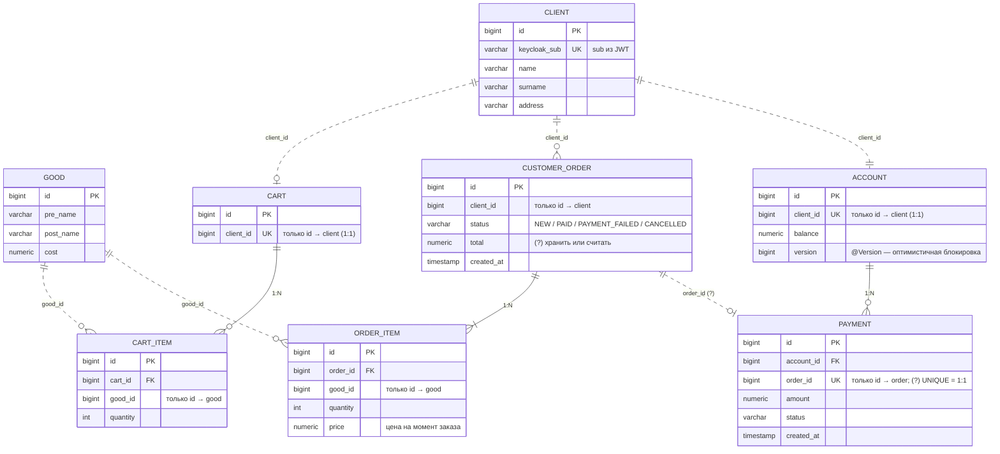

# MarketPlace_Back

Запуск keycloak:

Запуск PG:
docker run --name marketplace-pg -e POSTGRES_PASSWORD={pass} -v pgdata-mp:/var/lib/postgresql -p 5432:5432 -e POSTGRES_DB=marketplace -d postgres:18
Взаимодействие с PG:
docker exec -it <имя> psql -U postgres -d postgres:18

## Схема БД в формате ER-диаграммы

Запуск 